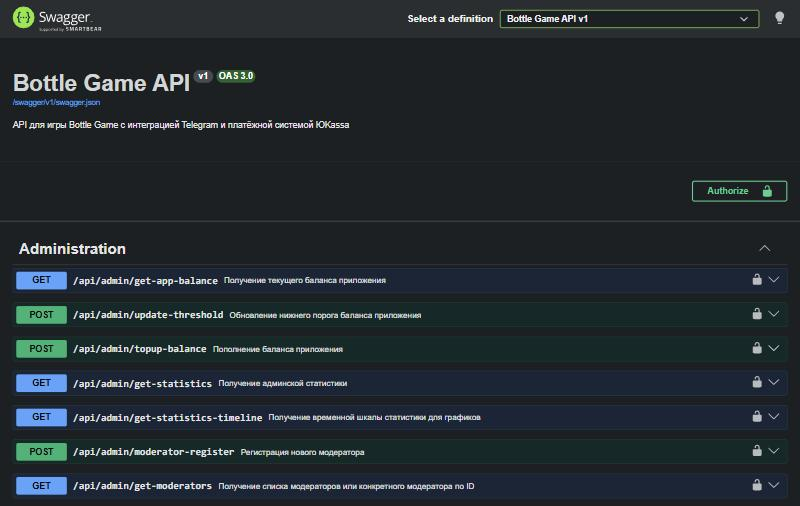
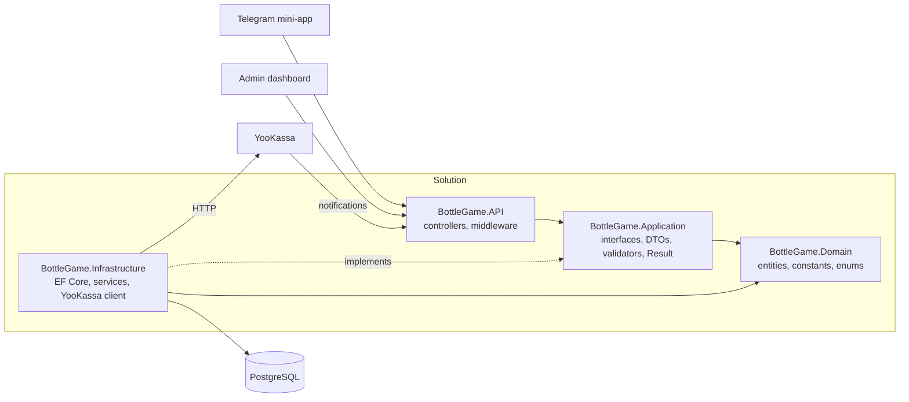

# Bottle Game API

[](https://github.com/Dgrabovets/BottleGameAPI/actions/workflows/ci.yml)

Backend for a Telegram mini-app game: player accounts, game rounds, balances, deposits and withdrawals, a referral programme and an admin API. Built with ASP.NET Core and PostgreSQL.

This is a portfolio project. It runs end to end in a demo mode with a virtual balance, and it includes a ready YooKassa client for real payments that is not connected to a live merchant account.

The companion admin dashboard lives in [BottleGameAdministrationPanel](https://github.com/Dgrabovets/BottleGameAdministrationPanel).



## Features

- **Telegram sign-in.** The mini-app `initData` is verified on the server and exchanged for a JWT. Roles: `Player`, `Moderator`, `Admin`. Staff sign in with a login and a salted, keyed password hash.
- **Game rounds.** Rounds are resolved from tunable game parameters (win chances, multipliers, boosts) that admins edit at runtime.
- **Balances and transactions.** Deposits and withdrawals with statuses, an application-level balance and a lower threshold for payouts.
- **Payment provider integration.** A YooKassa client creates payments and SBP payouts, and its notifications are handled safely: each one is re-checked against the YooKassa API, repeated deliveries never credit or refund twice, and concurrent deliveries are blocked by optimistic concurrency. The client is covered by tests against a fake HTTP handler.
- **Demo mode.** By default deposits and withdrawals complete instantly with a virtual balance, so the whole product can be tried without any payment account.
- **Referral programme.** Inviters earn a bonus on the deposits of the players they invited, unless they are banned.
- **Moderation.** Bans with history, player search and editing.
- **Administration and statistics.** Profit, general statistics and timelines for the dashboard.
- **Operations.** Request rate limiting per IP, structured logging with Serilog, a global exception handler, Swagger UI.

## Architecture



| Project | Responsibility |
|---|---|
| `BottleGame.API` | HTTP surface: controllers, authentication and authorization, rate limiting, error handling |
| `BottleGame.Application` | Use-case contracts: service interfaces, request and response DTOs, FluentValidation validators, the `Result` type |
| `BottleGame.Domain` | Entities, enums and constants without dependencies |
| `BottleGame.Infrastructure` | EF Core `DbContext` and mappings, service implementations, YooKassa client |
| `BottleGame.UnitTests` | xUnit tests on the EF Core in-memory provider |
| `BottleGame.IntegrationTests` | xUnit tests on a real PostgreSQL |

Service methods return a `Result` or `Result<T>` instead of throwing for expected failures. Controllers translate it to HTTP status codes in one place (`BaseApiController`).

## Getting started

Requirements: Docker, or the .NET 10 SDK and PostgreSQL.

```bash
docker compose up --build
```

The API listens on `http://localhost:8080` and Swagger UI is at `http://localhost:8080/swagger`. The compose file creates the database from `database/schema.sql`, loads reference data from `database/seed.sql` and demo content from `database/demo.sql`: eight players with rounds, deposits, withdrawals and a referral.

Staff sign-in for the demo: `demo-admin@example.com` / `demo-admin-password`. To see it in the dashboard, run [BottleGameAdministrationPanel](https://github.com/Dgrabovets/BottleGameAdministrationPanel) next to it (`npm run dev` in its `frontend` folder). Player endpoints need a Telegram mini-app session, so try the admin endpoints in Swagger or through the dashboard.

To run without Docker, create a database from the same SQL files and start the API with the settings below:

```bash
dotnet run --project BottleGame.API
```

### Configuration

Secrets are never stored in the repository. `appsettings.json` contains `ENV_` placeholders, and values come from environment variables:

| Variable | Purpose |
|---|---|
| `ConnectionStrings__PostgresConnection` | PostgreSQL connection string |
| `JWT__Key` | JWT signing key, at least 32 characters |
| `TelegramBotToken` | Bot token used to verify Telegram `initData` |
| `Security__PasswordHashSecretKey` | Secret mixed into admin password hashes |
| `Processing__Mode` | `Simulated` (default) completes deposits and withdrawals locally without real payments; `Live` uses YooKassa |
| `Processing__ShopId`, `Processing__SecretKey` | YooKassa shop credentials for accepting payments (required in `Live`) |
| `Processing__ReturnUrl` | Page where YooKassa sends the player after paying (required in `Live`) |
| `Processing__PayoutAgentId`, `Processing__PayoutSecretKey` | YooKassa payout gateway credentials; without them withdrawals are refused |
| `ForwardedHeaders__KnownProxies__0`, ... | IPs of reverse proxies whose `X-Forwarded-For` is trusted. Without them the header is trusted as is and clients can spoof the address used for rate limiting |
| `Swagger__Enabled` | `true` serves Swagger UI outside Development |
| `CORS__AllowedOrigins__0`, `__1`, ... | Allowed browser origins |

The deploy workflow builds `appsettings.Production.json` from GitHub Actions secrets and variables. Environment-specific values never live in the repository: `API_ALLOWED_ORIGINS` (comma-separated CORS origins), `TELEGRAM_APP_NAME`, `API_CERT_PATH` / `API_CERT_KEY_PATH` / `API_LISTEN_URL` (TLS, optional), `DEPLOY_PATH` and `DEPLOY_SCRIPT` (server side), plus (`YOOKASSA_SHOP_ID`, `YOOKASSA_SECRET_KEY`, `YOOKASSA_PAYOUT_AGENT_ID`, `YOOKASSA_PAYOUT_SECRET_KEY`, `YOOKASSA_RETURN_URL`) and the repository variable `PROCESSING_MODE` (defaults to `Simulated`).

### YooKassa

- Set the notification URL in the YooKassa dashboard (Integration, HTTP notifications) to `https://<your-api>/api/webhook/yookassa` and enable `payment.succeeded`, `payment.canceled`, `payout.succeeded` and `payout.canceled`.
- YooKassa does not sign notifications. The API reads only the object id from the body and fetches the payment or payout from YooKassa with its own credentials, so a forged notification cannot move money. It also checks that the transaction type and the amount match.
- Payouts use the SBP. A player's payout wallet is stored as `<phone>:<bank_id>`, where the bank id comes from YooKassa's `GET /v3/sbp_banks` list.
- Only RUB is supported.

## Tests

```bash
dotnet test
```

- `BottleGame.UnitTests` covers the services on the EF Core in-memory provider: players, bans, game rounds, transactions in both processing modes, YooKassa client (against a fake HTTP handler), notifications, statistics and dependency injection.
- `BottleGame.IntegrationTests` runs against a real PostgreSQL. Each run creates a throwaway database from `database/schema.sql` and `database/seed.sql`, so the tests also prove that the SQL scripts match the EF model. They cover duplicate and concurrent notifications, concurrent withdrawal approval and referral foreign keys. Without a server they are skipped; to run them:

```bash
docker run -d --name bottle-pg -e POSTGRES_PASSWORD=postgres -p 5433:5432 postgres:17-alpine
BOTTLEGAME_TEST_POSTGRES="Host=localhost;Port=5433;Username=postgres;Password=postgres" dotnet test BottleGame.IntegrationTests
```

Transactions carry a row version (PostgreSQL `xmin`) as an optimistic concurrency token, so two simultaneous requests cannot both apply the same notification or approve the same withdrawal.

## CI and deployment

- `ci.yml` builds and tests every pull request, including the integration tests against a PostgreSQL service container.
- `deploy.yml` runs the same checks on `main` and deploys only if they pass.

## Project status

The transaction flow has two modes, selected with `Processing__Mode`. `Simulated` (the default) completes deposits and withdrawals locally and is what the demo runs on. `Live` creates YooKassa payments and SBP payouts and applies withdrawal rules (minimum played rounds, payout limit). `Live` is covered by unit tests with a mocked provider and an HTTP-level fake, but it has not been run against a real YooKassa account, because the project is not connected to one.

Known gaps: receipts for the Russian fiscal law (54-FZ) are not sent, and payouts to bank cards need YooKassa's payout widget and are not implemented.
