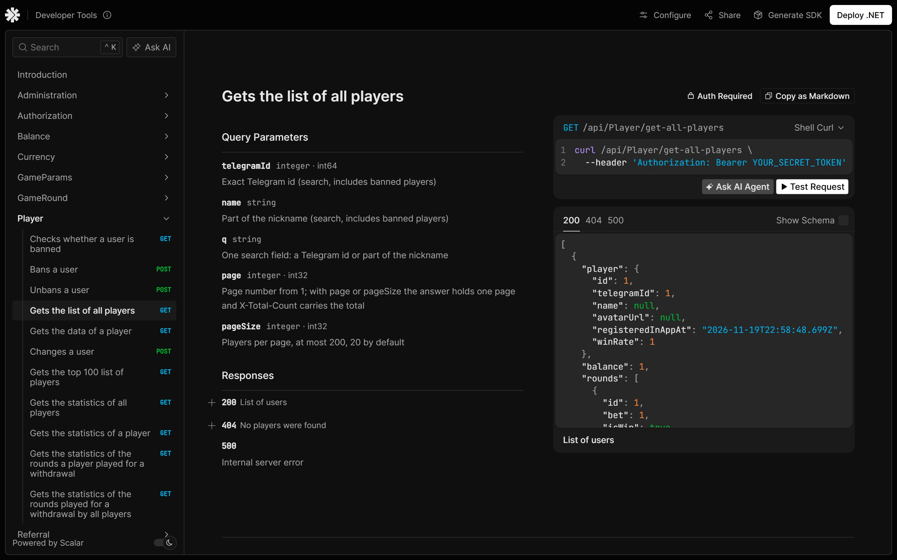
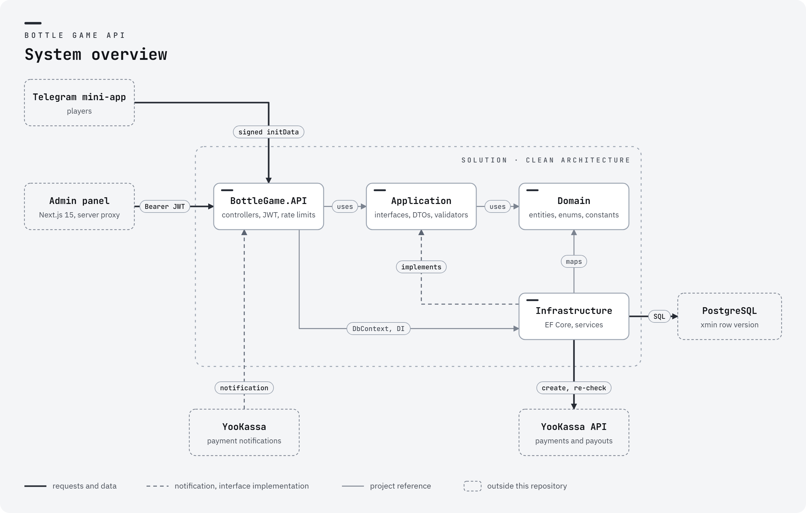
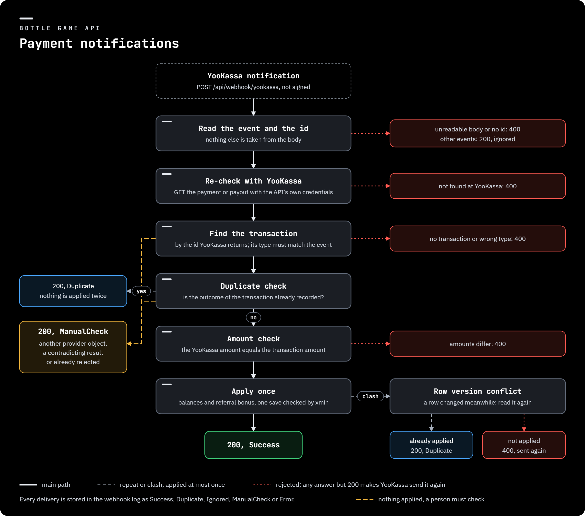
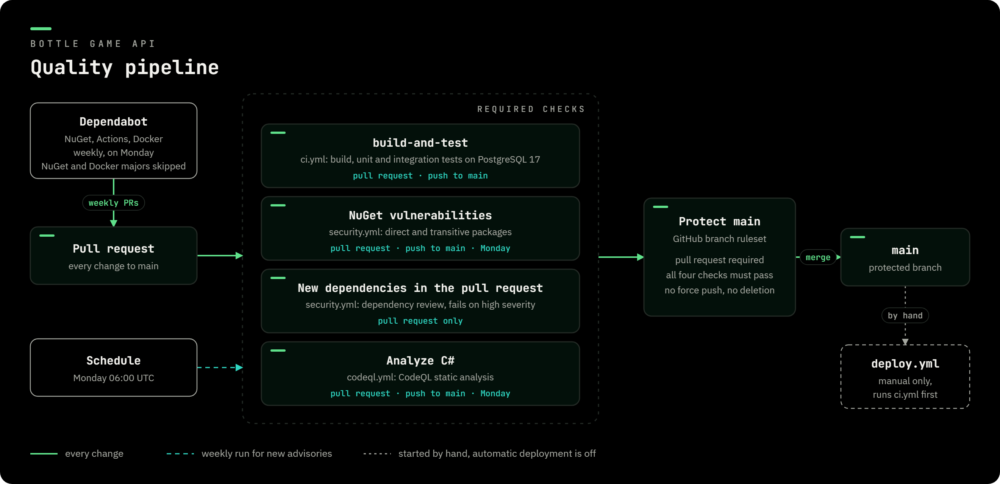

# Bottle Game API

[](https://github.com/Dgrabovets/BottleGameAPI/actions/workflows/ci.yml)
[](https://github.com/Dgrabovets/BottleGameAPI/actions/workflows/security.yml)
[](https://github.com/Dgrabovets/BottleGameAPI/actions/workflows/codeql.yml)


[](LICENSE)

Backend for a Telegram mini-app game: player accounts, game rounds, balances, deposits and withdrawals, a referral programme and an admin API. Built with ASP.NET Core and PostgreSQL.

This is a portfolio project. It runs end to end in a demo mode with a virtual balance, and it includes a ready YooKassa client for real payments that is not connected to a live merchant account.

The companion admin dashboard lives in [BottleGameAdministrationPanel](https://github.com/Dgrabovets/BottleGameAdministrationPanel).



## Features

- **Telegram sign-in.** The mini-app `initData` is verified on the server and exchanged for a JWT. Roles: `Player`, `Moderator`, `Admin`. Staff sign in with a login and a password stored as a salted PBKDF2 hash mixed with a server secret; hashes of the older format are replaced at the next sign-in.
- **Game rounds.** Rounds are resolved from tunable game parameters (win chances, multipliers, boosts) that admins edit at runtime.
- **Balances and transactions.** Deposits and withdrawals with statuses, an application-level balance and a lower threshold for payouts.
- **Payment provider integration.** A YooKassa client creates payments and SBP payouts, and its notifications are handled safely: each one is re-checked against the YooKassa API, repeated deliveries never credit or refund twice, and concurrent deliveries are blocked by optimistic concurrency. The client is covered by tests against a fake HTTP handler.
- **Paged lists and UTC dates.** The player and transaction lists take `page` and `pageSize` (at most 200) and return the size of the whole list in the `X-Total-Count` header, banned players are left out on the server. Dates are stored and returned in UTC with a `Z`.
- **Demo mode.** By default deposits and withdrawals complete instantly with a virtual balance, so the whole product can be tried without any payment account.
- **Referral programme.** Inviters earn a bonus on the deposits of the players they invited, unless they are banned.
- **Moderation.** Bans with history, player search and editing. A moderator can read players and transactions, approve or reject withdrawals and ban or unban players. Statistics, game settings, the application balance and the staff list are for administrators only.
- **Administration and statistics.** Profit, general statistics and timelines for the dashboard.
- **Operations.** Request rate limiting per IP, structured logging with Serilog (framework request logs only from Warning up, so the `initData` in the player sign-in path is not written), a global exception handler, an interactive API reference (Scalar).

## Architecture

<picture>
  <source media="(prefers-color-scheme: dark)" srcset="docs/diagrams/system-dark.png">
  
</picture>

The diagrams are SVG files in `docs/diagrams` (`system.svg`, `payment-notifications.svg`, `quality-pipeline.svg`), and the PNG pictures are rendered from them.

| Project | Responsibility |
|---|---|
| `BottleGame.API` | HTTP surface: controllers, authentication and authorization, rate limiting, error handling |
| `BottleGame.Application` | Use-case contracts: service interfaces, request and response DTOs, FluentValidation validators, the `Result` type |
| `BottleGame.Domain` | Entities, enums and constants without dependencies |
| `BottleGame.Infrastructure` | EF Core `DbContext` and mappings, service implementations, YooKassa client |
| `BottleGame.UnitTests` | xUnit tests on the EF Core in-memory provider |
| `BottleGame.IntegrationTests` | xUnit tests on a real PostgreSQL |

Service methods return a `Result` or `Result<T>` instead of throwing for expected failures. Controllers translate it to HTTP status codes in one place (`BaseApiController`).

## API overview

Every endpoint is described in the interactive API reference (see [Getting started](#getting-started)). The groups, with who may call them:

| Group | Base path | Access | What it does |
|---|---|---|---|
| Authorization | `/api/auth` | Anonymous login for staff and players, admin only for registration | Staff login, staff registration, player login from Telegram `initData` |
| Players | `/api/Player` | Admin or moderator to list, read, ban and unban; admin for edit and statistics; a player for its own profile | Search and list players, ban and unban, profile edit, top 100, statistics |
| Balance | `/api/Balance` | Admin or moderator for the transaction lists and for approving or rejecting; admin or player for the balance and new transactions | Balance, create a deposit or a withdrawal, transaction lists, approve or reject a withdrawal |
| Game rounds | `/api/GameRound` | Player or admin to finish a round; admin for the rest | Finish a round, played rounds of a player, profit |
| Game parameters | `/api/GameParams` | Admin to change; player or admin to read | Win chances, multipliers, payment and payout methods, currencies |
| Referrals | `/api/Referral` | Player or admin | Referral link of a player |
| Administration | `/api/admin` | Admin | Application balance and threshold, statistics, timelines, moderators |
| Currencies | `/api/currencies` | Anonymous reference data, admin to clear the cache | Currencies, payment gateways, exchange rates, amount validation |
| Webhook | `/api/webhook/yookassa` | Anonymous, every notification is re-checked with YooKassa; own rate limit and a 64 KB body limit | Payment and payout notifications |
| Health | `/api/Health` | Anonymous | Database and service health check |

Expected failures answer with the error text and a matching status (400, 401, 403, 404 or 409). Unhandled exceptions answer with JSON that has `statusCode`, `message` and `timestamp`, and in production the message does not include the exception text. A conflict between two simultaneous requests answers `409` and can be retried.

## Getting started

Requirements: Docker, or the .NET 11 SDK and PostgreSQL.

```bash
docker compose up --build
```

The API listens on `http://localhost:8080` and the interactive API reference (Scalar) is at `http://localhost:8080/scalar`. The compose file creates the database from `database/schema.sql`, loads reference data from `database/seed.sql` and demo content from `database/demo.sql`: eight players with rounds, deposits, withdrawals and a referral. The API runs in Development, the only environment where the compose placeholder secrets are accepted, and the port is published on `127.0.0.1` only.

Staff sign-in for the demo: `demo-admin@example.com` / `demo-admin-password`. To see it in the dashboard, run [BottleGameAdministrationPanel](https://github.com/Dgrabovets/BottleGameAdministrationPanel) next to it (`npm run dev` in its `frontend` folder). Player endpoints need a Telegram mini-app session, so try the admin endpoints in the API reference (sign in with `POST /api/auth/admin-login`, then paste the token into the Bearer authentication box) or through the dashboard.

To run without Docker, create a database from the same SQL files and start the API with the settings below:

```bash
dotnet run --project BottleGame.API
```

### Upgrading an existing database

`database/schema.sql` is only for new databases: Docker Compose runs it once, when the data volume is empty. A database created from an earlier version of it needs the scripts from `database/upgrade/`, in the order of their numbers; the API cannot read transactions without them. Each script can be run again safely.

1. Stop the API. The old version must not run during or after the upgrade, because it would no longer see which payouts may already exist.
2. Run the script:

```bash
psql -v ON_ERROR_STOP=1 -d <database> -f database/upgrade/001-payout-state.sql
```

3. Start the new version.

With Docker Compose, either delete the demo data with `docker compose down -v`, or keep it:

```bash
docker compose stop api
docker compose up -d --wait db
docker compose exec -T db psql -v ON_ERROR_STOP=1 -U bottle -d bottlegame < database/upgrade/001-payout-state.sql
docker compose up -d --build
```

`001-payout-state.sql` adds the payout columns to the transactions and moves the withdrawals with an unknown payout outcome from the error text to the new state. Their first request time and wallet were never stored, so they cannot be approved again: only the payout notification settles them.

### Configuration

Secrets are never stored in the repository. `appsettings.json` contains `ENV_` placeholders, and values come from environment variables:

| Variable | Purpose |
|---|---|
| `ConnectionStrings__PostgresConnection` | PostgreSQL connection string |
| `JWT__Key` | JWT signing key, at least 32 characters |
| `TelegramBotToken` | Bot token used to verify Telegram `initData`. Required: the API does not start when it is empty or an `ENV_` placeholder, or, outside Development, the compose placeholder |
| `Security__PasswordHashSecretKey` | Secret mixed into admin password hashes |
| `Telegram__InitDataMaxAgeMinutes` | How long a signed Telegram `initData` stays valid, 1440 (a day) by default; `0` turns the check off |
| `Processing__Mode` | `Simulated` (default) completes deposits and withdrawals locally without real payments; `Live` uses YooKassa |
| `Processing__ShopId`, `Processing__SecretKey` | YooKassa shop credentials for accepting payments (required in `Live`) |
| `Processing__ReturnUrl` | Page where YooKassa sends the player after paying (required in `Live`) |
| `Processing__PayoutAgentId`, `Processing__PayoutSecretKey` | YooKassa payout gateway credentials; without them withdrawals are refused |
| `Processing__PayoutRepeatWindowHours` | How long after the first request a payout with an unknown outcome may be sent again, from 1 to 24 hours, 24 by default |
| `ForwardedHeaders__KnownProxies__0`, ... | IPs of reverse proxies whose `X-Forwarded-For` is trusted. Without them only a proxy on the same machine is trusted, so a client cannot fake the address used for rate limiting; behind a proxy on another host, list it here, otherwise every client shares the proxy's address |
| `ApiDocs__Enabled` | `true` serves the OpenAPI document and the Scalar API reference outside Development |
| `CORS__AllowedOrigins__0`, `__1`, ... | Allowed browser origins |

The deploy workflow builds `appsettings.Production.json` from GitHub Actions secrets and variables. Environment-specific values never live in the repository: `API_ALLOWED_ORIGINS` (comma-separated CORS origins), `TELEGRAM_APP_NAME`, `API_CERT_PATH` / `API_CERT_KEY_PATH` / `API_LISTEN_URL` (TLS, optional), `DEPLOY_PATH` and `DEPLOY_SCRIPT` (server side), plus (`YOOKASSA_SHOP_ID`, `YOOKASSA_SECRET_KEY`, `YOOKASSA_PAYOUT_AGENT_ID`, `YOOKASSA_PAYOUT_SECRET_KEY`, `YOOKASSA_RETURN_URL`) and the repository variable `PROCESSING_MODE` (defaults to `Simulated`).

### YooKassa

- Set the notification URL in the YooKassa dashboard (Integration, HTTP notifications) to `https://<your-api>/api/webhook/yookassa` and enable `payment.succeeded`, `payment.canceled`, `payout.succeeded` and `payout.canceled`.
- YooKassa does not sign notifications. The API reads only the object id from the body and fetches the payment or payout from YooKassa with its own credentials, so a forged notification cannot move money. It also checks that the transaction type and the amount match.
- Only a 4xx answer to the first payout request returns the money to the player. After a timeout, a network error or a 5xx answer the payout may exist, so the withdrawal stays pending and cannot be rejected by hand: the `payout.succeeded` or `payout.canceled` notification settles it, or approving it again repeats the request with the same idempotence key `payout-<transaction id>`. A refused repeat leaves it pending too, because the first request may still have made the payout. Before the request is sent, the withdrawal is saved with the payout state "outcome unknown", the request time, the payout method and the wallet, so a reject or a ban that comes during the request or after a crash leaves it alone. A repeat sends the saved amount, currency, method and wallet, even if the player has changed the settings since. YooKassa keeps an idempotence key for a limited time (24 hours by its documentation), so a repeat is refused once that window (`Processing__PayoutRepeatWindowHours`) has passed since the first request; the withdrawal stays pending for a check in the YooKassa dashboard.
- A notification that contradicts the stored transaction (another payout id, a payout that succeeded after a refund, or any outcome for a withdrawal that was rejected by hand) is not applied. It is logged as critical and saved in the webhook log with the status `ManualCheck`.
- Payouts use the SBP. A player's payout wallet is stored as `<phone>:<bank_id>`, where the bank id comes from YooKassa's `GET /v3/sbp_banks` list.
- Only RUB is supported.



## Tests

```bash
dotnet test
```

- `BottleGame.UnitTests` covers the services on the EF Core in-memory provider: players, bans, game rounds, transactions in both processing modes, YooKassa client (against a fake HTTP handler), notifications, statistics and dependency injection.
- `BottleGame.IntegrationTests` runs against a real PostgreSQL. Each run creates throwaway databases from `database/schema.sql` and `database/seed.sql`. The tests compare the columns of `schema.sql` with the EF model and run the upgrade script on a database of the previous schema. They also cover duplicate and concurrent notifications, concurrent withdrawal approval, concurrent withdrawals of one balance and referral foreign keys. Without a server they are skipped; to run them:

```bash
docker run -d --name bottle-pg -e POSTGRES_PASSWORD=postgres -p 5433:5432 postgres:17-alpine
BOTTLEGAME_TEST_POSTGRES="Host=localhost;Port=5433;Username=postgres;Password=postgres" dotnet test BottleGame.IntegrationTests
```

Transactions and balances (a player's and the application's) carry a row version (PostgreSQL `xmin`) as an optimistic concurrency token. Two simultaneous requests cannot both apply the same notification, approve the same withdrawal or spend the same balance twice. For a withdrawal or a balance change the second request fails with 409 and can be retried. The notification handler reads the transaction again after a conflict: if the other request has already applied it, the answer is 200 (a duplicate); otherwise it answers 400, so YooKassa delivers the notification again.

## CI and deployment



- `ci.yml` builds and tests every pull request and every push to `main`, including the integration tests against a PostgreSQL service container.
- `security.yml` (Dependency audit) lists vulnerable NuGet packages, direct and transitive, on every pull request, every push to `main` and every Monday, and reviews the dependencies a pull request adds.
- `codeql.yml` runs GitHub CodeQL static analysis of the C# code on the same schedule.
- Dependabot checks NuGet packages, GitHub Actions and Docker images every Monday and opens one pull request for the Microsoft and EF Core packages (with Npgsql) and one for the test packages; every other NuGet package gets its own. Major versions of NuGet packages and Docker images are left for manual upgrades, because the Microsoft packages and the images must stay on the same major version as the .NET SDK.
- A branch ruleset protects `main`: changes arrive only through a pull request, the four checks `build-and-test`, `NuGet vulnerabilities`, `New dependencies in the pull request` and `Analyze C#` must pass, and force pushes and deletion are blocked.
- `deploy.yml` first runs `ci.yml` (build and tests) and deploys only if it passes. Automatic deployment is switched off: the workflow starts only by hand from the Actions tab (add `push: branches: [main]` back to deploy on every merge). Put the output of `ssh-keyscan <server>` into the `SSH_KNOWN_HOSTS` secret to pin the server host key; without it the deploy still runs but does not verify the server and prints a warning.

## Project status

The transaction flow has two modes, selected with `Processing__Mode`. `Simulated` (the default) completes deposits and withdrawals locally and is what the demo runs on. `Live` creates YooKassa payments and SBP payouts and applies withdrawal rules (minimum played rounds, payout limit). `Live` is covered by unit tests with a mocked provider and an HTTP-level fake, but it has not been run against a real YooKassa account, because the project is not connected to one. Do not switch it on before the known limitations below are fixed.

Known gaps: receipts for the Russian fiscal law (54-FZ) are not sent, and payouts to bank cards need YooKassa's payout widget and are not implemented.

### Known limitations

This project was frozen before it was finished, and these points are left as they were on purpose. They matter before any real use:

- **The client reports the game result.** `finish-game-round` takes the bet and the win flag from the mini-app, and the server only applies them. A player who calls the endpoint directly can credit any amount to their own balance. A real deployment needs the outcome to be drawn on the server, from the player's win chance, with the bet taken from a round the server has started.
- **What this means for withdrawals.** A win skips the balance check (only a loss needs enough balance), so a player with an empty balance can still report wins of up to 1 000 000 per round. Every reported round, real or not, also counts toward the minimum number of rounds needed for a withdrawal. The payout limit (10% of the lower threshold of the application balance) applies to each transaction only, not to a player or a day, so a forged balance can be withdrawn in many small payouts. In `Simulated` mode this balance is virtual. In `Live` mode it is paid out as real money, so `Live` mode must not be used until the game result is drawn on the server.
- **A stuck withdrawal cannot be closed through the API.** A withdrawal with an unknown payout outcome is settled only by a payout notification or by a successful repeat. If the repeat window has passed and no notification comes (for example, the first request never reached YooKassa), it stays pending: check it in the YooKassa dashboard and correct the database by hand.

#### How the game result could be fixed

1. `start-game-round` takes the bet, takes it from the balance at once and stores an open round on the server.
2. The server draws the outcome from the player's win chance and the game parameters. Today the chance model (the decrease per throw and per rotation) lives in the mini-app, so it has to move to the server first.
3. `finish-game-round` takes only the round id, no bet and no win flag. Closing a round that is already closed returns the same result.
4. Tests: a client that sends another bet or result changes nothing, and two simultaneous finish calls settle the round once (the same row-version idea as for withdrawals).

## License

[MIT](LICENSE), copyright (c) 2026 Danila Grabovets.
